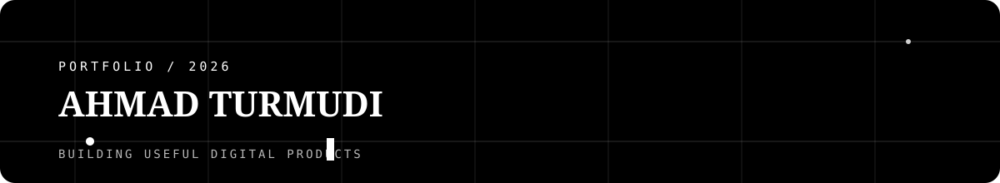

<div align="center">



# Ahmad Turmudi

**Informatics student · Web developer · UI/UX enthusiast**

Building thoughtful digital experiences, one project at a time.

[](https://github.com/AHTURRR)
[](mailto:turmudi811@gmail.com)
[](https://www.linkedin.com/in/ahmad-turmudi-4a3aab353)
[](https://instagram.com/ahmdtrmdi)

</div>

---

### 01 / THE IDEA

> **Build with purpose. Design with clarity. Keep learning.**

I enjoy creating web applications that make ideas useful and accessible. My work brings together full-stack development, interface design, and curiosity about AI-assisted tools.

- **Building:** web applications and digital product experiences.
- **Learning:** full-stack architecture, UI/UX, and AI-assisted workflows.
- **Open to:** collaboration on creative projects and useful open-source software.

### 02 / SELECTED WORK

<table>
<tr><td width="50%">

#### 🌿 AgriVision

An AI-assisted plant disease identification application using leaf images, with diagnosis history and feedback.

`Laravel` · `React` · `TypeScript` · `Gemini`

[Explore repository →](https://github.com/AHTURRR/AgriVision)

</td><td width="50%">

#### ◈ DORA — Product Website

A product profile and download website for Data Overview & Research Assistant, with previews, documentation, and team information.

`React` · `TypeScript` · `Vite`

[Explore repository →](https://github.com/AHTURRR/Website-Profiling-DORA.)

</td></tr>
<tr><td colspan="2">

#### ▦ Laravel Library System

A library application exploring migrations, seeders, Eloquent accessors, and scopes.

`Laravel` · `PHP` · `MySQL` · `Bootstrap` · [Explore repository →](https://github.com/AHTURRR/tugas2-mvc-laravel_PemWeb2_pertem-10)

</td></tr>
</table>

[View all repositories →](https://github.com/AHTURRR?tab=repositories)

### 03 / THE TOOLKIT

**Development**  
`PHP`  ·  `Laravel`  ·  `JavaScript`  ·  `TypeScript`  ·  `React`  
`HTML`  ·  `CSS`  ·  `Tailwind CSS`  ·  `Bootstrap`

**Data & creative tools**  
`MySQL`  ·  `Git`  ·  `GitHub`  ·  `Figma`  ·  `VS Code`

### 04 / ACTIVITY

My GitHub profile shows my contribution history, pinned projects, and current activity.

**[Explore contributions and activity →](https://github.com/AHTURRR)**  
**[Browse repositories →](https://github.com/AHTURRR?tab=repositories)**

### 05 / MINI CHALLENGE

<details>
<summary>🎮 Find the bug — click to play</summary>

What does this JavaScript expression return?

```js
typeof null
```

<details>
<summary>Reveal answer</summary>

`"object"`. This is a long-standing JavaScript behavior; use `value === null` to check for null.

</details>
</details>

<details>
<summary>🧩 Design challenge — click to play</summary>

Choose one: **clarity**, **contrast**, or **consistency**. Now find one place in a project where you can improve it.

</details>

---

<div align="center">

### Let's build something useful.

[Email](mailto:turmudi811@gmail.com) · [LinkedIn](https://www.linkedin.com/in/ahmad-turmudi-4a3aab353) · [Instagram](https://instagram.com/ahmdtrmdi) · [GitHub](https://github.com/AHTURRR)

<sub>Designed with curiosity · Built with purpose</sub>

</div>
