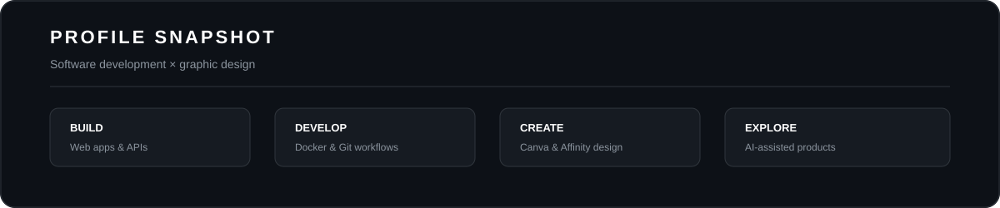

# AHMAD TURMUDI

**Software Developer · Web Developer · Graphic Designer**

Building functional software and visual experiences with equal attention to structure and detail.

---

### ✦ BUILD · DESIGN · LEARN ✦

`Software development`  ·  `Web applications`  ·  `Graphic design`  ·  `AI-assisted workflows`

## About me

I am an Informatics student with experience in software development and graphic design. I enjoy turning ideas into useful products: from database-backed applications and development environments to visual assets, layouts, and digital brand experiences.

<table>
<tr>
<td width="33%" align="center">

**BUILDING**

Web applications  
APIs · databases · interfaces

</td>
<td width="33%" align="center">

**DEVELOPING**

Software workflows  
Docker · Git · testing · deployment

</td>
<td width="33%" align="center">

**CREATING**

Graphic assets  
Layouts · branding · digital content

</td>
</tr>
</table>

## Selected projects

<table>
<tr>
<td width="50%" valign="top">

### 🌿 AgriVision

AI-assisted plant disease identification from leaf images, with authentication, diagnosis history, feedback, and recommendations.

**Stack:** Laravel · React · TypeScript · Gemini AI

[View project →](https://github.com/AHTURRR/AgriVision)

</td>
<td width="50%" valign="top">

### ◈ Website Profiling DORA

A product profile and download website with application previews, documentation, release information, and team content.

**Stack:** React · TypeScript · Vite · CSS

[View project →](https://github.com/AHTURRR/Website-Profiling-DORA.)

</td>
</tr>
<tr>
<td colspan="2">

### ▦ Laravel Library System

A library application built to explore migrations, seeders, Eloquent accessors, scopes, route testing, and database views.

**Stack:** Laravel · PHP · MySQL · Bootstrap · [View project →](https://github.com/AHTURRR/tugas2-mvc-laravel_PemWeb2_pertem-10)

</td>
</tr>
</table>

[Browse all repositories →](https://github.com/AHTURRR?tab=repositories)

## ✦ TECH ARSENAL ✦

### Languages

### Frameworks and platforms

### Developer tools and infrastructure

### Creative tools

 

Python · C++ · PHP · JavaScript · TypeScript · Java · HTML · CSS · Bash  
Laravel · React · Node.js · Vite · Tailwind CSS · Bootstrap · TensorFlow  
Docker · Git · GitHub · GitHub Actions · Linux · VS Code · Postman · MySQL  
Canva · Affinity · Figma · Photoshop · Illustrator

## ✦ PROFILE SNAPSHOT ✦

## ✦ CONTRIBUTIONS ✦

[Open my GitHub activity →](https://github.com/AHTURRR)

Contribution cards are linked to GitHub so the profile remains useful when third-party image services are unavailable.

## Development and design workflow

<table align="center">
<tr>
<td align="center"><strong>01</strong> Understand</td>
<td align="center">→</td>
<td align="center"><strong>02</strong> Plan</td>
<td align="center">→</td>
<td align="center"><strong>03</strong> Build</td>
<td align="center">→</td>
<td align="center"><strong>04</strong> Refine</td>
<td align="center">→</td>
<td align="center"><strong>05</strong> Share</td>
</tr>
</table>

## Mini challenge

🎮 Find the bug

What does `typeof null` return?

Reveal answer

`"object"`. Use `value === null` when checking for null.

🎨 Design challenge

Choose one principle—**clarity**, **contrast**, or **consistency**—and improve one screen in your next project.

---

### LET'S BUILD SOMETHING USEFUL

[Email](mailto:turmudi811@gmail.com) · [LinkedIn](https://www.linkedin.com/in/ahmad-turmudi-4a3aab353) · [Instagram](https://instagram.com/ahmdtrmdi) · [GitHub](https://github.com/AHTURRR)

Designed with curiosity · Built with purpose

